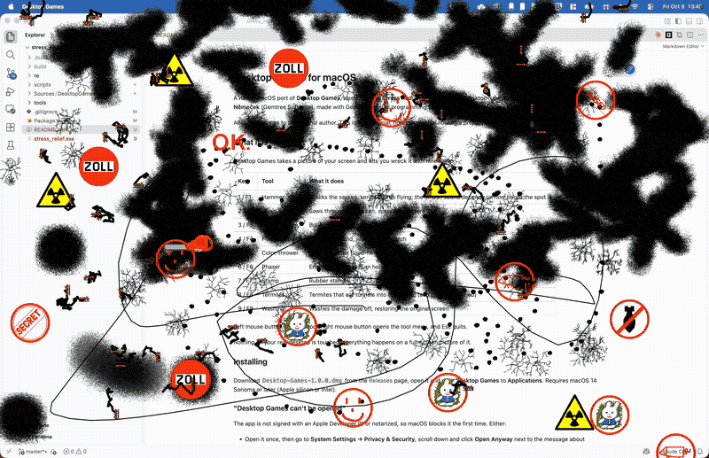

# Desktop Games Nostalgia

A faithful port of **Desktop Games**, also known as **Stress Reducers**, to macOS and the browser. It is the freeware desktop-smashing toy from 2000 by **Ing. Miroslav Němeček** (Gemtree Software), made with Gemtree's visual programming tool *Peter*.

All credit belongs to the original author. This is an unofficial, non-commercial nostalgia project, not affiliated with Gemtree.



## What it is

Desktop Games takes a picture of your screen and lets you wreck it with nine tools:

| Key | Tool | What it does |
|---|---|---|
| 1 / F1 | Hammer | Cracks the screen, sends shards flying; the smash sound depends on how bright the spot is |
| 2 / F2 | Chain-saw | Saws through the screen, spraying splinters |
| 3 / F3 | Machine gun | Bullet holes and ejected shells |
| 4 / F4 | Flame-thrower | Flames that land, wander and scorch |
| 5 / F5 | Color-thrower | Paint blots that flood-fill what they hit |
| 6 / F6 | Phaser | Energy blasts that burn holes |
| 7 / F7 | Stamp | Rubber stamps |
| 8 / F8 | Termites | Termites that eat tunnels into the screen (and can be squished) |
| 9 / F9 | Washing | Washes the damage off, restoring the original screen |

Left mouse button uses the tool, right mouse button opens the tool menu, and Esc quits.

It comes in two versions:

- **macOS app**: plays on a picture of your actual screen.
- **Browser**: plays on a Windows XP desktop, since a web page cannot take a picture of your screen.

Either way, nothing real is touched: everything happens on a full-screen picture.

## Play in your browser

Open **[ucodia.github.io/desktop-games-nostalgia](https://ucodia.github.io/desktop-games-nostalgia)** and double-click **stress.exe** on the desktop. You need a desktop browser with a mouse and keyboard.

## Install on macOS

Download `Desktop-Games-1.0.0.dmg` from the [Releases](../../releases) page, open it and drag **Desktop Games** to **Applications**. Requires macOS 14 Sonoma or later (Apple silicon or Intel).

### Screen Recording permission

To play on your actual screen, the app needs **Screen Recording** access (it takes a single screenshot when the game starts). Without it, you play on your wallpaper.

On first launch, macOS asks whether Desktop Games may record your screen:

1. Click **Open System Settings**, then turn on **Desktop Games** in **Privacy & Security → Screen & System Audio Recording**.
2. When macOS asks, click **Quit & Reopen**. macOS only applies the permission after the app restarts; if you choose **Later**, quit and reopen Desktop Games yourself.

macOS only shows that popup once. If you dismissed it, Desktop Games offers **Open System Settings** or **Play on Wallpaper** on its intro window the next time you launch it.

If Desktop Games does not appear in the list, quit System Settings and open it again (the list does not always refresh, and in stubborn cases only a restart of the Mac helps). You can also add the app with the **+** button below the list, or reset its permission state and launch it again:

```sh
tccutil reset ScreenCapture io.github.ucodia.desktopgames
```

If you used the earlier unsigned download, macOS treats this signed version as a different app: turn Desktop Games off and on again in the list (or remove it and run the reset command above) once.

## How it was made

The port was produced with **Claude Opus 5.5** (Anthropic's model, in Claude Code) using the **[REA](https://rea.tools/)** reverse-engineering tools, with Ghidra as the analysis backend.

- **The game is a Peter program.** `stress_relief.exe` is Gemtree's generic Peter interpreter with the actual game stored in a `.petprg` section: a program tree plus its pictures, sprites, sounds and texts in 23 languages.
- **The program tree was decompiled** into readable pseudocode that keeps the original English names and comments: see [`re/program.txt`](re/program.txt) (`re/decompile.py`).
- **The interpreter was decompiled with REA** to recover what the program tree alone does not say: the image compression codec, the asset record layouts, the 55 ms timer tick, how sprites glide, animate and turn, how sounds loop and restart, and the coordinate system (1 unit = 32 pixels, y pointing up).
- **The assets were extracted** from the original executable into [`re/assets`](re/assets) (`re/extract.py`): images decoded to PNG, Microsoft ADPCM sounds to WAV.
- **The game logic was ported line by line to Swift** ([`macos/Sources/DesktopGames/DesktopGames.swift`](macos/Sources/DesktopGames/DesktopGames.swift)), running on a small reimplementation of the Peter runtime: sprites, drawing canvas, software sound mixer and input.
- **The Swift port was then translated to JavaScript** for the browser ([`web/src/game.js`](web/src/game.js)), with the same runtime pieces built on Canvas 2D and Web Audio. The Windows XP look comes from [XP.css](https://botoxparty.github.io/XP.css/).

Differences from the original: the game runs in true color instead of Peter's 256-color palette (the color-thrower's flood fill still treats colors as equal when they map to the same palette entry), and sprite shadows are drawn as a translucent black overlay.

## Building from source

The assets extracted from the original game are included in `re/assets`, so building does not need the original executable.

### macOS app

Requirements: macOS 14 or later, Xcode with Swift 6, and [uv](https://docs.astral.sh/uv/).

1. Build the app:

   ```sh
   ./macos/scripts/build-app.sh
   ```

   The result is `macos/build/Desktop Games.app`.
2. Optionally package it as a disk image with `./macos/scripts/make-dmg.sh`.

`"macos/build/Desktop Games.app/Contents/MacOS/DesktopGames" --selftest <dir>` plays every tool headlessly with scripted input and writes screenshots to `<dir>`.

The app is ad-hoc signed unless `CODESIGN_IDENTITY` names a Developer ID certificate. A signed and notarized release is built with:

```sh
export CODESIGN_IDENTITY="Developer ID Application: Your Name (TEAMID)"
./macos/scripts/build-app.sh
./macos/scripts/notarize.sh "macos/build/Desktop Games.app"
./macos/scripts/make-dmg.sh
./macos/scripts/notarize.sh macos/build/Desktop-Games-1.0.0.dmg
```

`notarize.sh` uses the notarytool keychain profile named by `NOTARY_PROFILE` (default `desktop-games-nostalgia`), created with `xcrun notarytool store-credentials`.

### Browser version

Requirements: Node.js 20 or later.

```sh
cd web
npm install
npm run dev       # or: npm run build, which writes the site to web/dist
```

Every push to `main` that changes the site deploys it to GitHub Pages.

### Extracting the assets again

Requirements: [uv](https://docs.astral.sh/uv/).

1. Download the original game from [My Abandonware](https://www.myabandonware.com/game/stress-reducers-e8l) and put `stress_relief.exe` in `re/`. The port was made from the file with SHA-256 `bdb0ab60e058dc1a70fc6a0f38996609d656ca8c605172077d8d19a4ef6ef337`.
2. Extract the assets and decompile the program:

   ```sh
   cd re
   uv run extract.py stress_relief.exe assets
   uv run decompile.py stress_relief.exe > program.txt
   ```

## Repository layout

| Path | Contents |
|---|---|
| `re/` | Reverse engineering: Python tools that read the Peter program, decompile it and extract the assets |
| `re/program.txt` | The decompiled game program |
| `re/assets/` | The extracted pictures, sprites, sounds and icons, shared by the builds |
| `macos/` | The macOS app: the Swift port of the game and the Peter runtime pieces it needs, plus build and packaging scripts |
| `web/` | The browser version: the JavaScript port and the Windows XP desktop |

## Copyright

Desktop Games / Stress Reducers, including its design, artwork and sounds, is © Ing. Miroslav Němeček, Gemtree Software. This repository is shared for preservation and nostalgia and comes with no license. If you hold the rights and want it changed or taken down, please open an issue.

The browser version's Windows XP desktop uses the Bliss wallpaper (photo by Charles O'Rear), the Windows logo and the Notepad icon, all © Microsoft and used here for nostalgia only. XP.css is © Adam Hammad, MIT license.
